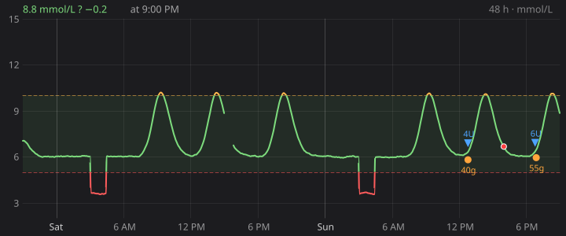

# xDrip+ Top Bar (GNOME 46)

A GNOME Shell extension that shows your latest [xDrip+](https://github.com/NightscoutFoundation/xDrip) glucose reading in the top bar, with a zoomable 48-hour graph. It brings its own background collector that follows **xDrip+ Cloud Sync** as a passive follower, so it needs no Nightscout server.



*The preview above is drawn from made-up readings.*

> **Not a medical device.** This is a convenience display. Don't base treatment decisions on it, and rely on xDrip+ itself for alarms. Readings can be late, missing or wrong.

Shows your latest xDrip+ reading in the top bar, as `6.4 → 3m` (mmol/L, trend arrow, minutes since the reading). Click it to see a 48-hour graph styled like the xDrip+ main screen: dots coloured by range, the target band shaded, insulin as blue ▼ and carbs as orange ●, finger-sticks as red dots, and all times on a 12-hour clock.

## Install

```sh
./install.sh            # checks requirements, copies, compiles the schema, runs the collector self-test
# log out and back in once (Wayland)
gnome-extensions enable xdrip-topbar@local
gnome-extensions prefs  xdrip-topbar@local
```

In Settings, enter your sync key and choose the data folder.

You need: `python3-cryptography`, `gjs` and `gir1.2-secret-1`. The installer tells you if any of them are missing.

## How it works

- **Collector.** When the extension is turned on, it starts `collector/xdrip_gnome_collector.py`, and stops it when the extension is turned off.
  - It keeps running while the screen is locked. Your reading is hidden on the lock screen itself.
  - If the collector stops unexpectedly, it is restarted 30 seconds later.
  - It also exits on its own if GNOME Shell goes away.
- **Passive by default.** The collector only listens. Switch on *Active* if you want it to appear in xDrip+'s followers list. It uses the name you set, `gnome_info_collector` by default.
- **Sync key.** It is stored in GNOME Keyring. The extension passes it to the collector through stdin, so it never appears on a command line or in a file.
- **Data folder** (chosen in Settings, default `~/.local/share/xdrip-topbar`):
  - `latest.json`: newest reading plus collector status
  - `history.json`: rolling 48 hours of readings, treatments and finger-sticks
  - `collector.log`: output of the current run
  - `.collector_token`, `.collector.lock`: internal files the collector uses
- **Treatments.** Insulin and carbs only arrive while the collector is running, at the moment you enter or edit them on the phone. Anything entered while it was off won't be in the graph.

## Updating keeps your settings

Running `./install.sh` again only replaces the program files.
- **Your settings** (colours, range, position, zoom, sizes, data folder…) are stored in GNOME's settings database (dconf), not in the extension folder, so updates don't touch them.
- **Your sync key** stays in GNOME Keyring.
- **Your collected data** stays in your data folder.

As a safety net, the installer saves a copy of your settings to `~/.local/share/xdrip-topbar-settings-backup.ini` before every update. To restore it:

```sh
dconf load /org/gnome/shell/extensions/xdrip-topbar/ < ~/.local/share/xdrip-topbar-settings-backup.ini
```

## Graph controls

| Action | What it does |
|---|---|
| Mouse wheel | Zooms between 1 and 48 hours. The zoom level is remembered. |
| Shift + wheel, or scrolling sideways | Moves back and forward through the 48 hours. |
| Middle click | Shows all 48 hours again. |
| ◢ corner (dropdown) | Drag to resize. The size is remembered. |

## Privacy

- Your sync key stays in GNOME Keyring on your machine.
- Glucose and treatment data are only written to the data folder you choose.
- In passive mode, nothing is ever sent to the xDrip+ group.
- Don't commit your data folder or sync key anywhere public.

## Credits and licence

The Cloud Sync protocol details (server, framing, encryption) come from reading the open-source xDrip+ app (GPL-3.0). This project is also GPL-3.0, so see `LICENSE`. It isn't affiliated with the xDrip+ or Nightscout projects.

## Testing without GNOME

```sh
python3 collector/xdrip_gnome_collector.py --selftest
# a manual run against the real server (key from the environment):
XDRIP_SYNC_KEY='…' python3 collector/xdrip_gnome_collector.py --data-dir /tmp/xd --no-parent-watch
```

To see extension errors: `journalctl -f -o cat /usr/bin/gnome-shell`. For the settings and history windows: `journalctl -f -o cat /usr/bin/gjs`.

This is a convenience display, not a medical device. Rely on xDrip+ for alarms.
