# xDrip+ Tray for Windows

[](https://github.com/Electrik-rich546456/xdrip-gnome-topbar/releases?q=windows&expanded=true) [](https://github.com/Electrik-rich546456/xdrip-gnome-topbar/releases/latest) [](LICENSE)

> 🐧 **On Ubuntu / Linux?** Use **[xDrip+ Top Bar for Ubuntu](https://github.com/Electrik-rich546456/xdrip-gnome-topbar)** instead. It's a GNOME top-bar extension with the same graph.

Shows your latest [xDrip+](https://github.com/NightscoutFoundation/xDrip) glucose reading on Windows in two places:
- **Tray icon:** the reading appears as a number in your range colour. Hover over it to see the trend arrow and how many minutes ago the reading was.
- **Floating widget:** a small always-on-top box showing `6.4 → 3m` that you can drag anywhere.

Click either one to open a **zoomable 48-hour graph** showing your readings, insulin and carbs. Readings can be shown in **mmol/L or mg/dL**.

The app gets your readings by itself, from either of two places:
- **xDrip+ Cloud Sync**, like a follower phone. No Nightscout is needed.
- **Your Nightscout site.**

You don't need Python or anything else installed.

> **Not a medical device.** This is a convenience display. Don't base treatment decisions on it, and rely on xDrip+ itself for alarms. Readings can be late, missing or wrong.

## Screenshots

*Taken automatically on a Windows PC with made-up readings. They're refreshed whenever the app changes.*

**The graph:** 48 hours, with insulin (blue ▼), carbs (orange ●) and a finger-stick (red dot)
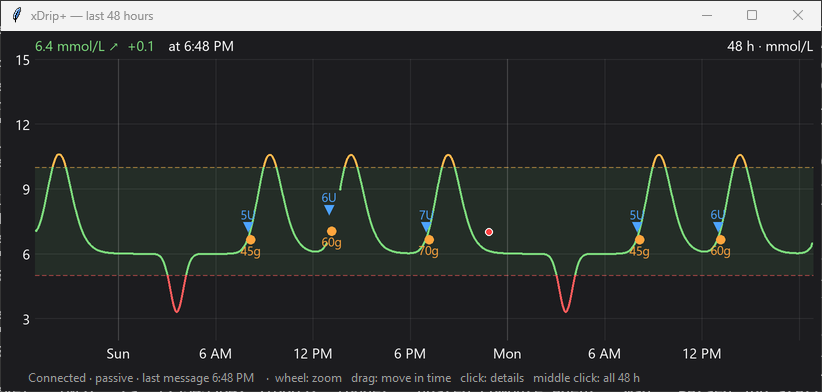

| Zoomed in to 8 hours | In mg/dL |
|---|---|
| 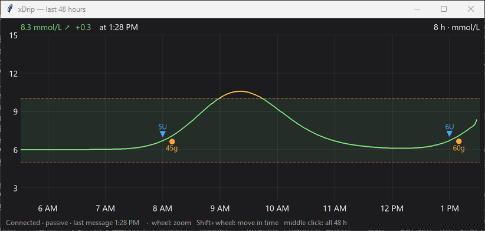 | 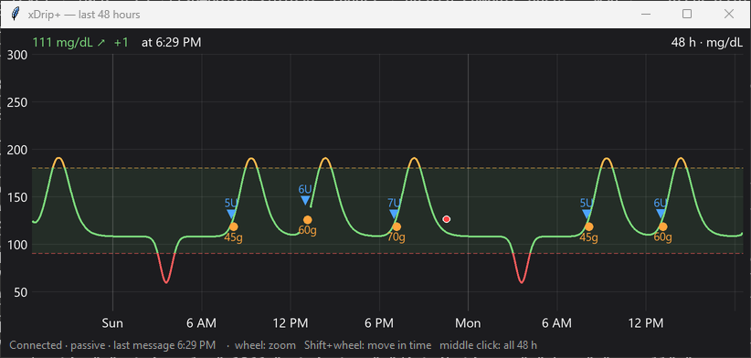 |

**Click an item** to see its exact time:
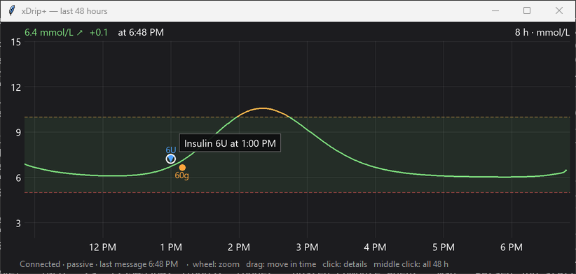

| Floating widget | Tray icon (enlarged) |
|---|---|
| 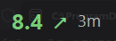 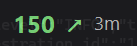 | 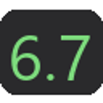 |

| Settings: xDrip+ Cloud Sync | Settings: Nightscout |
|---|---|
| 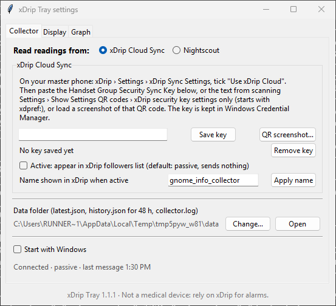 | 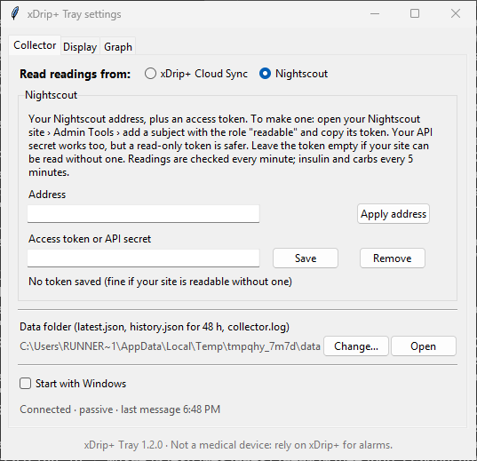 |

| Settings: Display | Settings: Graph |
|---|---|
| 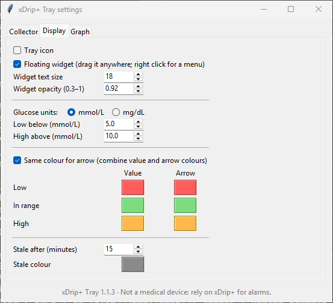 | 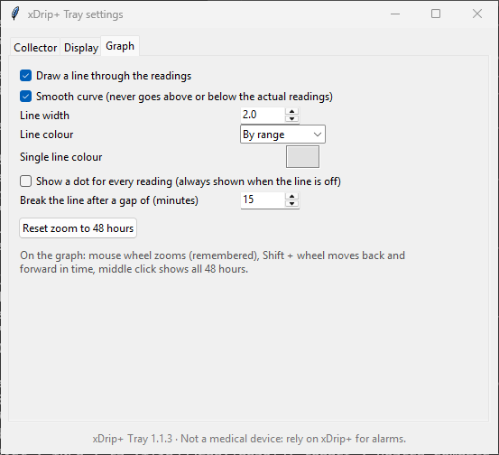 |

| Settings: About |
|---|
| 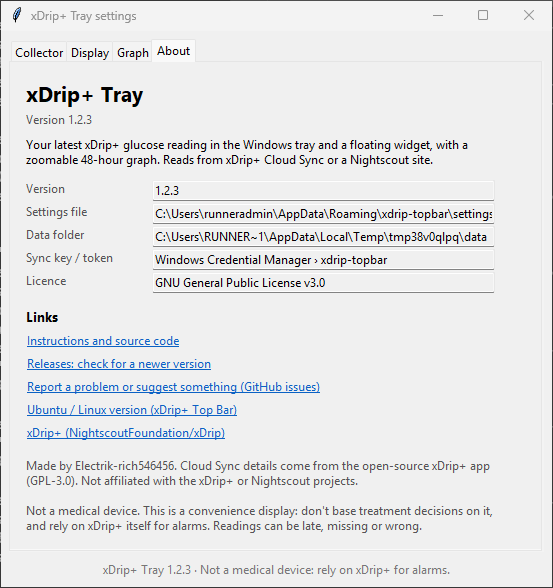 |

## 1. Download

1. Go to the [Windows releases](https://github.com/Electrik-rich546456/xdrip-gnome-topbar/releases?q=windows&expanded=true) and open the newest **xDrip+ Tray for Windows** release.
2. Download **`xDripTray.exe`**.
3. Put it somewhere permanent, for example a new folder `C:\Users\<you>\Apps\xDripTray\`. It's a single file, so there's no installer.

**If Windows shows "Windows protected your PC":** Windows SmartScreen shows this the first time you run a new app that isn't yet widely downloaded or code-signed. This app is a small open-source project, and free code signing through the [SignPath Foundation](https://signpath.org) is planned (see the [code signing policy](CODE_SIGNING_POLICY.md)). Click **More info › Run anyway**. Windows won't ask again for this file.

**Checking that the file is genuine (optional):** every release is built by GitHub Actions from this public repository, and GitHub signs a record of each build. You can check it either way:
```powershell
# with the GitHub CLI (https://cli.github.com):
gh attestation verify .\xDripTray.exe --repo Electrik-rich546456/xdrip-gnome-topbar

# or compare the checksum with xDripTray.exe.sha256 from the same release:
Get-FileHash .\xDripTray.exe -Algorithm SHA256
```

## 2a. Using Nightscout?

Skip section 2b if your readings are on a Nightscout site, for example because your phone isn't an xDrip+ master and everything is uploaded to Nightscout.
1. **Make a read-only token** (recommended): open your Nightscout site › **Admin Tools** › **Add new Subject**. Give it the role **readable**, save it, and copy the token shown next to it. It looks like `topbar-1a2b3c4d5e6f7a8b`. Your API secret works too, but a read-only token can't change anything and is easy to revoke.
2. **Enter it in the app:** run `xDripTray.exe`. In Settings › **Collector**, choose **Read readings from: Nightscout**.
3. Enter your site address, e.g. `https://mysite.example.com`, and click **Apply address**.
4. Paste the token and click **Save**. If your site can be read without a token, leave it empty.

The app checks for new readings every minute, and for insulin, carbs and finger-sticks every 5 minutes. It only reads from Nightscout and never writes to it. The token is kept in Windows Credential Manager.

## 2b. Get your sync key (xDrip+ Cloud Sync)

Do all of this on your **master** phone, the one connected to the sensor.

**First, check sync is on:** in xDrip+, go to **Settings › xDrip+ Sync Settings**. Make sure **Be master for followers** and **Use xDrip+ Cloud** are both ticked. If you can't find xDrip+ Sync Settings, look under **Less Common Settings**.

Run `xDripTray.exe`. The Settings window opens by itself the first time. On the **Collector** tab, use any one of these three ways:

### A. QR code screenshot (easiest)
1. In xDrip+, go to **Settings › Show Settings QR codes**, near the bottom, and choose **xDrip+ security key settings only**.
2. Take a screenshot and copy it to your PC.
3. Click **QR screenshot…** and choose the image.
4. **Delete the screenshot afterwards.** It contains your key.

### B. Scanned QR text
1. Show the same QR code as in A.
2. Scan it with any QR scanner app, such as your phone camera or Google Lens on another phone.
3. Copy the text. It starts with `xdpref:` or `xdp2:`.
4. Paste it into the key box and click **Save key**. The app takes the key out of the text by itself.

### C. Type the key
1. In xDrip+, go to **Settings › xDrip+ Sync Settings › Handset Group Security Sync Key**.
2. Copy it into the key box and click **Save key**.

The key is stored in **Windows Credential Manager**, under the name `xdrip-topbar`. It's never shown again and never saved in a plain file. Anyone with your key can read your glucose data, so treat it like a password.

Within a few minutes, the tray icon and widget show your reading.

## 3. Using it

| Where | What to do |
|---|---|
| Tray icon | Hover for the reading, arrow and minutes ago. **Left click** for the graph. **Right click** for the menu: graph, widget on/off, settings, data folder, quit. |
| Widget | **Drag** to move it, and its position is remembered. **Click** for the graph. **Right click** for the menu. |
| Graph | **Mouse wheel** zooms between 1 and 48 hours, and the zoom is remembered. **Click and drag** left or right, or use **Shift + wheel**, to move back and forward in time. **Click** a reading, insulin, carbs or finger-stick to see its exact time and value, either in a small popup next to it or in the line at the bottom (Settings › Graph). **Middle click** shows all 48 hours again. The window remembers its size and position. |

To keep the tray icon visible all the time, go to **Windows Settings › Personalization › Taskbar › Other system tray icons** and turn on **xDripTray**. On Windows 10 you can drag the icon out of the `^` overflow area instead.

## 4. Settings

The Settings window is available from the tray or widget menu.

**Collector tab**
- **Read readings from:** xDrip+ Cloud Sync or Nightscout. Each one shows its own settings below the choice.
- **Sync key:** paste the key, load a QR screenshot, or remove the saved key.
- **Active:** off by default (passive), so the app only listens and sends nothing. When on, the app shows up in xDrip+'s **System status › Followers** list under the name you set, `gnome_info_collector` by default.
- **Data folder:** where your readings are kept.
- **Start with Windows:** starts the app when you log in.

**Display tab**
- **Tray icon and widget:** turn each one on or off. At least one stays on.
- **Widget appearance:** text size and opacity.
- **Glucose units:** mmol/L (the default) or mg/dL.
- **Target range:** low and high limits, shown in your chosen unit. The defaults are 5.0 and 10.0 mmol/L (90 and 180 mg/dL).
- **Colours:**
  - The value and the arrow each have their own colour for low, in range and high. Tick **Same colour for arrow** to combine them.
  - The stale colour is used once no reading has arrived for longer than the time you set.

**Graph tab**
- Line on or off, smooth or straight, line width, and line colour (by range or one colour).
- Where the details of a clicked item appear: a small popup next to it, or the line at the bottom.
- A dot for every reading.
- Where the line breaks at a gap.
- Reset zoom.

**About tab**
- Version, where your settings and data are kept, links to the instructions, new releases and issue reports, and the licence.

## Where things are stored

| What | Where |
|---|---|
| Settings | `%APPDATA%\xdrip-topbar\settings.json` |
| Readings (rolling 48 h), latest reading, log | `%LOCALAPPDATA%\xdrip-topbar\`, or the folder you chose. Contains `history.json`, `latest.json` and `collector.log` |
| Sync key, Nightscout token | Windows Credential Manager › Windows Credentials › `xdrip-topbar` |

**Updating:** quit the app from the tray menu, replace `xDripTray.exe` with the new one, and start it again. Your settings, key and readings are kept.

**Uninstalling:**
1. Quit the app and untick **Start with Windows** first.
2. Delete the .exe and the two folders listed in "Where things are stored".
3. Remove the `xdrip-topbar` entry from Credential Manager.

## Troubleshooting

| Problem | What to check |
|---|---|
| Shows `--` and never a reading | **Use xDrip+ Cloud** must be on, on the master phone. Re-save the key, and use option A or B if unsure. Then look at `collector.log` in the data folder, which is reachable from the tray menu › Open data folder. |
| "could not decode … sync key mismatch?" in the log | Wrong key. Copy it again from the master phone. |
| "Nightscout refused access (HTTP 401)" | The token or API secret is wrong, or your site needs one and none is saved. Make a new token with the **readable** role. |
| "Nightscout answered HTTP …" or can't be reached | Check the address opens in a browser, and that it starts with `https://`. |
| Tray icon sometimes missing | Update to 1.1.3 or newer, which adds the icon again if Windows loses it, for example when the app starts at login before the taskbar is ready. Also keep `xDripTray.exe` in one place with the same name: Windows remembers "show this icon" by file location, so a new download saved as `xDripTray (1).exe` or in another folder starts out hidden again. |
| "Another copy is already collecting" | The app is already running. Check the tray, including the `^` overflow area. |
| Readings stop after the PC sleeps | The app reconnects by itself within a few minutes of waking. Meanwhile the reading turns your stale colour. |
| Insulin or carbs missing from the graph | Treatments only arrive while the app is running, at the moment they're entered or edited on the phone. |

## Privacy

- **Passive mode (the default):** the app sends nothing to your xDrip+ group. It only makes the connection and sends the acknowledgements the Cloud Sync protocol needs.
- **Nightscout:** the app only reads from your site and never writes to it.
- **Your data:** readings stay in your data folder. Nothing is uploaded anywhere else.
- **Your key and token:** they're only in Windows Credential Manager.

## Building it yourself

The `.github/workflows/windows.yml` workflow builds the .exe with PyInstaller on GitHub's Windows machines, runs the self-tests, and publishes it as a Release. To run the app from source instead:
```powershell
pip install pystray pillow keyring cryptography zxing-cpp
python windows\xdrip_tray.py
```
